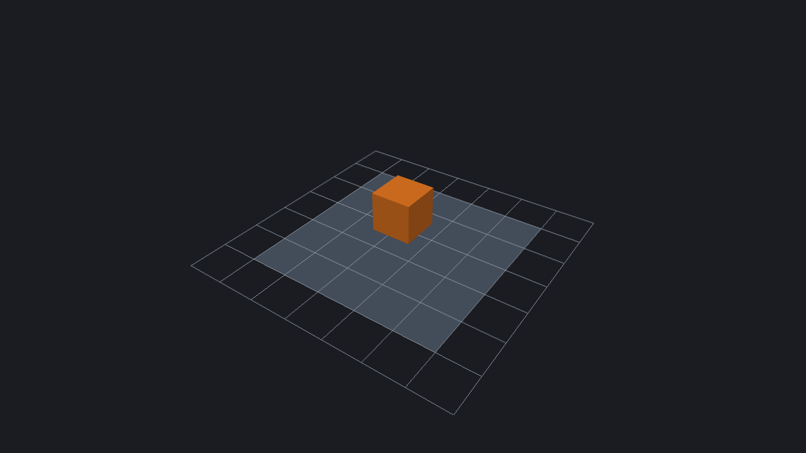

# LegacyEngine

Trying to make a custom game engine with AI



## What it does so far

LegacyEngine opens a window onto a small 3D world:

- a 7 × 7 grid on the ground, 1 m per grid block
- a solid 5 × 5 m plane lying on the grid, centred on the origin
- a 1 m cube floating above the plane, with its centre at (0, 1, 0)

Press `F` and the cube falls onto the plane. Left-click to create a coloured 1 m cube at
the spot under the pointer; new cubes have gravity and collide with the scene.

One unit is one metre, +Y points up and the ground is the XZ plane.

| Input | Action |
| --- | --- |
| `F` | Drop the cube. Pressing it again puts the cube back and drops it once more |
| Left click | Spawn a cube under the pointer |
| Drag with the left mouse button | Orbit around the scene (movement beyond 5 window units) |
| Mouse wheel | Zoom in and out |
| `Esc`, or closing the window | Quit |

Clicks hit the nearest solid surface, or the ground at y = 0 when nothing solid is under the
pointer (up to 100 m away). A sky click places a cube at the camera target's distance.
Cubes are offset to touch the surface and moved nearby if space is blocked. Colours cycle
through blue, green, yellow, red, purple and turquoise.

Only the plane is solid ground: cubes outside it fall and are removed below y = −200 m.
The original orange cube stays fixed until `F`; if it later falls out of the scene, it is
kept there without a `RigidBody` so `F` can bring it back. Tall stacks may wobble or collapse.

It is written in C++17 with:

- [SDL3](https://www.libsdl.org/) for the window, the input and the OpenGL context
- OpenGL 3.3 (core profile) for the rendering
- [GLAD](https://github.com/Dav1dde/glad) for loading the OpenGL functions (generated code in `third_party/glad`)
- [ReactPhysics3D](https://www.reactphysics3d.com/) for the physics: gravity and collisions

Only Linux has been built and tested so far.

## Adding objects

The scene is put together in `run()` in [`src/main.cpp`](src/main.cpp). Every object in it is an
*entity*: an id with *components* attached to it, and the components decide what the object is.

| Component | What it gives the entity |
| --- | --- |
| `Transform` | A position, a rotation and a scale |
| `MeshRenderer` | A mesh and a colour: the entity is drawn |
| `BoxCollider` | A solid box around it: other solid entities cannot pass through |
| `RigidBody` | Physics: the entity falls, and collisions push it around |

For example, this adds a blue crate that falls onto the plane beside the cube:

```cpp
const Entity crate = world.create();
world.add(crate, Transform{{1.5f, 3.0f, 0.0f}});
world.add(crate, MeshRenderer{cubeMesh, {0.20f, 0.45f, 0.90f}});
world.add(crate, BoxCollider{});
world.add(crate, RigidBody{});
```

Without the `RigidBody`, the crate is an obstacle that stays where it was put. Without the
`BoxCollider` as well, it is only drawn.

Components are plain structs, and a change to one takes effect on the next frame:

```cpp
world.get<Transform>(crate).position = {0.0f, 4.0f, 0.0f}; // move it above the cube
world.get<MeshRenderer>(crate).color = {0.9f, 0.1f, 0.1f}; // paint it red
world.remove<RigidBody>(crate);                            // stop it where it is
world.destroy(crate);                                      // or take it out of the scene
```

Any struct of your own can be a component too, and `world.each()` visits every entity that has
the components it names. This makes the crate spin while it falls:

```cpp
struct Spin {
    float speed = 1.0f; // radians per second
    float angle = 0.0f;
};

// Where the scene is put together:
world.add(crate, Spin{2.0f});

// In the main loop, before physics.update():
world.each<Transform, Spin>([&](Entity, Transform& transform, Spin& spin) {
    spin.angle += spin.speed * seconds;
    transform.rotation = axisAngle({0.0f, 1.0f, 0.0f}, spin.angle);
});
```

A mesh is a list of triangles, and it can be shared by any number of entities. `makeBox()` and
`makePlane()` build the two shapes of the scene; any other shape is three vertices per triangle,
each with a position and a normal. This puts a red pyramid on the plane:

```cpp
MeshData pyramid;
const Vec3 tip = {0.0f, 1.0f, 0.0f};
const Vec3 corners[4] = {
    {-0.5f, 0.0f, 0.5f}, {0.5f, 0.0f, 0.5f}, {0.5f, 0.0f, -0.5f}, {-0.5f, 0.0f, -0.5f}};
for (int i = 0; i < 4; ++i) {
    // One side. Seen from outside, its vertices run counter-clockwise.
    const Vec3 a      = corners[i];
    const Vec3 b      = corners[(i + 1) % 4];
    const Vec3 normal = normalize(cross(b - a, tip - a)); // points away from the side
    pyramid.vertices.push_back({a, normal});
    pyramid.vertices.push_back({b, normal});
    pyramid.vertices.push_back({tip, normal});
}
const MeshHandle pyramidMesh = renderer.createMesh(pyramid);

const Entity roof = world.create();
world.add(roof, Transform{{-1.5f, 0.0f, 0.0f}});
world.add(roof, MeshRenderer{pyramidMesh, {0.80f, 0.20f, 0.20f}});
```

There is no loader for model files such as `.obj` yet; one would fill a `MeshData` in the same way.
Colliders are boxes only, so far.

The code is in `src`:

| File | What is in it |
| --- | --- |
| `main.cpp` | The scene, the input and the main loop |
| `ecs.hpp` | `World`, which holds the entities and their components |
| `components.hpp` | The four components above |
| `mesh.hpp` | What a mesh is made of, and the box, the plane and the grid |
| `renderer.hpp` | Drawing with OpenGL. `createMesh()` takes the triangles of any shape |
| `physics.hpp` | The ReactPhysics3D simulation, plus `raycast()` and `checkBox()` queries |
| `camera.hpp`, `math.hpp` | The orbit camera, `rayThrough()` for picking, rays, vectors, rotations and matrices |

## Download

Linux x86_64 binaries are published on the
[releases page](https://github.com/monsef64/LegacyEngine/releases). For example, for version `v0.1.0`:

```sh
tar -xzf LegacyEngine-v0.1.0-linux-x86_64.tar.gz
./LegacyEngine-v0.1.0-linux-x86_64/LegacyEngine
```

The binary is built on Ubuntu 24.04. It needs a graphics driver with OpenGL 3.3 and glibc 2.38 or
newer, so it runs on Ubuntu 24.04 and Debian 13, for example, but not on Ubuntu 22.04. SDL and
ReactPhysics3D are linked into it, so there is nothing else to install.

## Build

You need a C++17 compiler, CMake 3.16 or newer, Git, and the development packages that SDL builds
against. On Ubuntu and Debian:

```sh
sudo apt-get install build-essential cmake git pkg-config \
  libx11-dev libxext-dev libxrandr-dev libxcursor-dev libxfixes-dev \
  libxi-dev libxss-dev libxtst-dev \
  libwayland-dev libxkbcommon-dev libdecor-0-dev \
  libgl1-mesa-dev libegl1-mesa-dev libgles2-mesa-dev libdrm-dev libgbm-dev \
  libdbus-1-dev libibus-1.0-dev libudev-dev libusb-1.0-0-dev \
  libasound2-dev libpulse-dev libpipewire-0.3-dev libjack-dev libsndio-dev \
  libfribidi-dev libthai-dev liburing-dev
```

Then:

```sh
cmake -S . -B build
cmake --build build --parallel 4
./build/LegacyEngine
```

The first command downloads SDL 3.4.20 and ReactPhysics3D 0.10.2, and the second one builds them
into the executable. If SDL3 is already installed on your system, that one is used instead; add
`-DLEGACY_VENDORED_SDL=ON` to the first command to download it anyway.

## Release

Pushing a tag that starts with `v` runs the [release workflow](.github/workflows/release.yml). It
builds the Linux binary, checks that it starts, and publishes it as a GitHub release:

```sh
git tag v0.1.0
git push origin v0.1.0
```

The workflow can also be started by hand from the Actions tab. On a branch, that only builds the
binary and attaches it to the workflow run.
