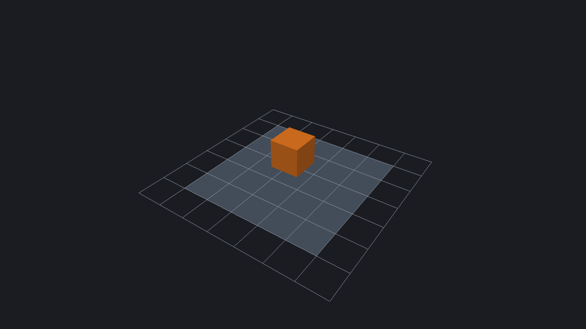

# LegacyEngine documentation

[Complete Scripting Reference: every function, method and event with examples](scripting-reference.md)


LegacyEngine is a C++17 3D editor with LegacyScript scripting, built on SDL3 and OpenGL.



## Get started

1. [Build and run the engine](building.md), or download an engine release artifact.
2. Learn the [editor workflow](editor.md) and [project/asset layout](projects.md).
3. Read the [LegacyScript guide](scripting.md) and [audio/input APIs](audio-input.md).
4. Configure [lighting](lighting.md), [materials](materials.md), and [skyboxes](skybox.md).

## Downloadable documentation

The **Release** workflow builds a standalone HTML/CSS site and uploads
**legacyengine-docs** alongside the engine package and **legacyscript-vsix**.
Extract the docs artifact and open `index.html` directly in a browser; no server,
JavaScript, or internet connection is required. Tagged releases also attach
`legacyengine-docs.zip`. The engine archive includes the same site in `docs/`.

## Build this documentation

Requires Python 3.9 or newer. From the repository root:

```sh
python3 -m venv .venv
.venv/bin/python -m pip install -r docs/requirements.txt
.venv/bin/python -m unittest discover -s docs/tests
.venv/bin/python docs/build.py --output build/docs
```

On Windows, use `.venv\Scripts\python.exe` instead. Source pages are Markdown
in `docs/`; `navigation.json` controls their order and titles. Presentation is in
`style.css`. Generated HTML is not committed. The builder rejects missing pages,
broken internal links, duplicate destinations, and output paths that could overwrite
the source tree. Repository-source links point to the revision used for the build.
